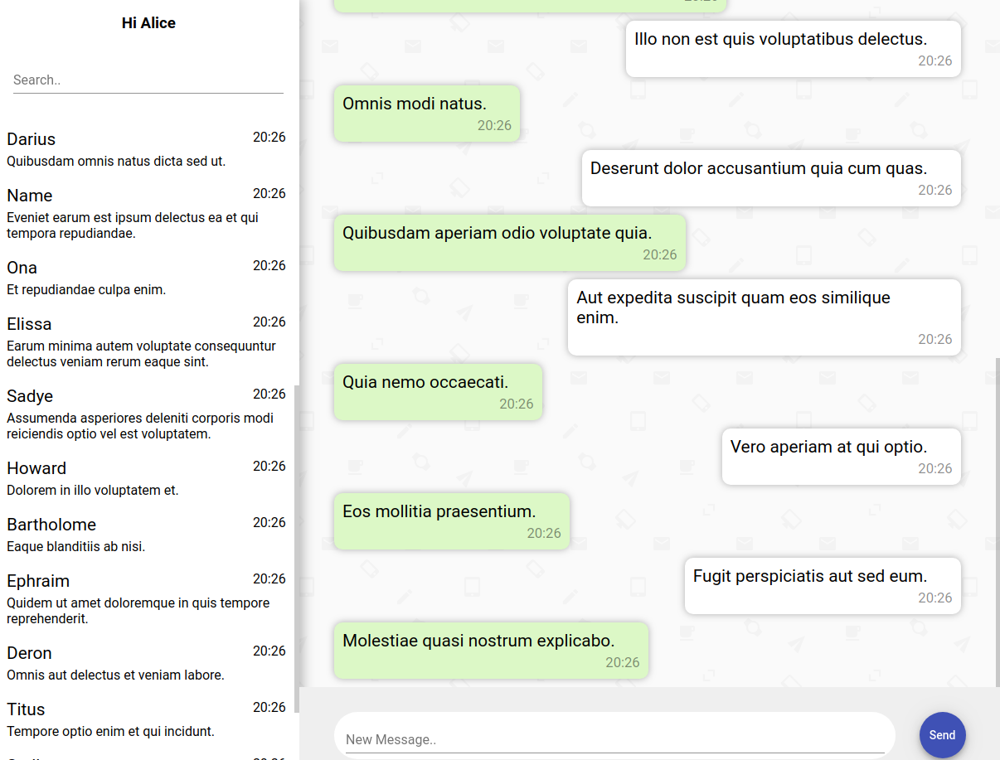

# Local First Database Comparison

In this project I have implemented the exact same chat application with different local first database technologies.
You can use it to compare metrics and learn about the differences. The chat app is a web based **angular** application, with functionality similar to Whatsapp Web.

  

## Implemented Databases:
  - AWS Amplify Datastore
  - Firebase Firestore
  - [PouchDB](https://github.com/pouchdb/pouchdb) with IndexedDB adapter & CouchDB replication
  - [RxDB LocalStorage](https://rxdb.info/rx-storage-localstorage.html) with LocalStorage Storage & GraphQL replication
  - [RxDB Dexie.js](https://rxdb.info/rx-storage-dexie.html) with Dexie.js Storage & GraphQL replication
  - [WatermelonDB](https://github.com/Nozbe/WatermelonDB) with LokiJS adapter (no backend sync atm)
  - [PGlite](https://github.com/electric-sql/pglite) (Postgres in WASM) with IndexedDB persistence and live queries (no backend sync atm)
  - [SQLite Wasm](https://sqlite.org/wasm) with the OPFS SyncAccessHandle Pool VFS in a WebWorker (no backend sync atm)

## Metrics

All metrics are measured automatically via code in a browser tests (chrome:headless). The results heavily depend on the developers device. You should compare the values relative to another and not as absolute values. Also you might want to create new metrics that better represent how you would use the respective database.

You can reproduce these values by running `sh measure-metrics.sh` in the root folder.

<!-- !!! DO NOT EDIT THIS TABLE DIRECTLY, IT IS GENERATED BY ./scripts/aggregate-metrics.mjs !!! -->

| Metric \ Project                        | rxdb-localstorage | rxdb-dexie | pouchdb | watermelondb | aws    | firebase | pglite  | sqlite-wasm |
| --------------------------------------- | ----------------- | ---------- | ------- | ------------ | ------ | -------- | ------- | ----------- |
| Bundle size, plain JavaScript           | 988kb             | 1088kb     | 911kb   | 1055kb       | 1954kb | 1083kb   | 1393kb  | 969kb       |
| Bundle size (js+wasm), minified+gzip    | 247kb             | 280kb      | 223kb   | 245kb        | 455kb  | 272kb    | 6044kb  | 641kb       |
| First angular component render          | 136ms             | 129ms      | 131ms   | 138ms        | 129ms  | 162ms    | 135ms   | 131ms       |
| Page load time                          | 195ms             | 171ms      | 166ms   | 176ms        | 164ms  | 203ms    | 173ms   | 164ms       |
| First full render                       | 179ms             | 301ms      | 597ms   | 192ms        | 257ms  | 595ms    | 1559ms  | 268ms       |
| Insert one message                      | 6ms               | 16ms       | 16ms    | 4ms          | 17ms   | 229ms    | 136ms   | 12ms        |
| Inserting 20 messages one after another | 128ms             | 156ms      | 113ms   | 94ms         | 307ms  | 3949ms   | 4986ms  | 161ms       |
| Inserting 20 messages in parallel       | 27ms              | 130ms      | 46ms    | 82ms         | 65ms   | 2520ms   | 2389ms  | 53ms        |
| Message insert to message list change   | 4ms               | 15ms       | 104ms   | 3ms          | 33ms   | 19ms     | 286ms   | 14ms        |
| Message search query time               | 7ms               | 30ms       | 56ms    | 6ms          | 326ms  | 170ms    | 147ms   | 5ms         |
| First full render with many messages    | 185ms             | 393ms      | 980ms   | 166ms        | 278ms  | 690ms    | 1577ms  | 213ms       |
| Storage usage                           | 727kb             | 1344kb     | 1569kb  | 1256kb       | 105kb  | 884kb    | 15226kb | 5286kb      |

### Metrics Explanation
- Bundle size, plain JavaScript: The full JavaScript bundle size (including WebWorker code), without minification or gzip.
- Bundle size (js+wasm), minified+gzip: The full JavaScript bundle size (including WebWorker code) plus the size of the WebAssembly files and PGlite's data bundle, after minification and gzip compression.
- Page load time: How long does it take to download and parse the JavaScript bundle.
- First angular component render: How long does it take for the first angular component to be rendered.
- First full render: How long does it take until all relevant data is displayed for the first time.
- Insert one message: How long does it take to insert a single message.
- Inserting 20 messages one after another: How long does it take to insert 20 messages in serial.
- Inserting 20 messages in parallel: How long does it take to insert 20 messages in parallel.
- Message insert to message list change: How long does it take until a new message is rendered to the dom.
- User change to message list change: How long does it take from changing the user to the displaying of the new messages list.
- Message search query time: How long does it take to search for a given message by regex/like-operator.
- First full render with many messages: Time to first full render when many messages exist.
- Storage usage: Size of the stored data (IndexedDB, OPFS and localStorage) after inserting the full test dataset.

## Investigations

### Why is LokiJS so much faster?

WatermelonDB uses the [LokiJS](https://github.com/techfort/LokiJS) database as storage, which is an **in memory** database that regularly persists the data to IndexedDB either on interval, or when the browser tab is closed. By doing so, [less slow IndexedDB transaction are used](https://rxdb.info/slow-indexeddb.html). Keeping and processing the data in memory has the benefit of being much faster, but it also has its downsides:

- Initial page load is much slower when much data is already stored in the database, because all data must be loaded before any database operation can be done.
- All data must fit into memory.
- Data can be lost when the JavaScript process is killed ungracefully like when the browser crashes or the power of the PC is terminated.
- There is no multi-tab-support with plain LokiJS. The data is not shared between multiple browser tabs of the same origin.

### Why is Firebase so slow on first render?

On the first page load, Firebase ensures that the local data is equal to the server side state. This means that the client has to be online at application startup which is the reason why Firebase is not completely offline first. To ensure the equalness of client side data, Firebase has to perform several requests to the backend, before the database will respond to queries. This makes the inital page load slow, and it becomes even more slower, the more data exists and has to be validated.

### Why is PouchDB so slow?

For the PouchDB and RxDB (with PouchDB storage) I used the [old](https://www.npmjs.com/package/pouchdb-adapter-idb) Indexeddb adapter.
It is much less optimized than the [new](https://www.npmjs.com/package/pouchdb-adapter-indexeddb) adapter, but the new one made problems with returning the correct query results.
Theses problems have been fixed on the PouchDB master branch, but I have to wait for the next PouchDB release. I will update the repo when this change can be done.

### Why does AWS Datastore need so much less storage space?

AWS Datastore does not save any metadata together with the documents. Instead only the plain documents are stored in IndexedDB. They can do this because they only allow simple queries and do not keep a local version history.

## Feature Map

<!-- !!! DO NOT EDIT THIS TABLE DIRECTLY, IT IS GENERATED BY ./scripts/generate-feature-table.ts !!! -->

| Feature \ Project        | aws                | firebase                                     | pouchdb | rxdb-localstorage | rxdb-dexie | watermelondb                           | pglite                                     | sqlite-wasm |
| ------------------------ | ------------------ | -------------------------------------------- | ------- | ----------------- | ---------- | -------------------------------------- | ------------------------------------------ | ----------- |
| Offline First            | No, login required | Partially, must be online on first page load | **Yes** | **Yes**           | **Yes**    | **Yes**                                | **Yes**                                    | **Yes**     |
| Realtime Replication     | **Yes**            | **Yes**                                      | **Yes** | **Yes**           | **Yes**    | Partially, must be implemented by hand | Partially, read-path sync with ElectricSQL | No          |
| Multi Tab Support        | **Yes**            | **Yes**                                      | No      | **Yes**           | **Yes**    | Partially, relies on online sync       | Partially, requires PGliteWorker           | No          |
| Observable Queries       | No                 | **Yes**                                      | No      | **Yes**           | **Yes**    | **Yes**                                | **Yes**                                    | No          |
| Complex Queries          | No                 | **Yes**                                      | **Yes** | **Yes**           | **Yes**    | **Yes**                                | **Yes**                                    | **Yes**     |
| Client Side Encryption   | No                 | No                                           | **Yes** | **Yes**           | **Yes**    | No                                     | No                                         | No          |
| Schema Support           | **Yes**            | No                                           | No      | **Yes**           | **Yes**    | **Yes**                                | **Yes**                                    | **Yes**     |
| Custom Backend           | No                 | No                                           | No      | **Yes**           | **Yes**    | **Yes**                                | No                                         | No          |
| Custom Conflict Handling | **Yes**            | No                                           | **Yes** | **Yes**           | **Yes**    | No                                     | No                                         | No          |

## Starting the projects

All sub-projects use the same port and so can **not be started in parallel**.

### Installation

* You must have [installed Node.js](https://nodejs.org/en/download/)
* Clone this project
* In the root folder, run `npm install` to install the dependencies.
* In the root folder, run `npm run build` to build all projects.

### Firebase Firestore

* Run `npm run start:firebase` to start the mock server and the production build frontend.
* Or run `npm run dev:firebase` to start the mock server and the development frontend server.

* Open [http://localhost:3000/](http://localhost:3000/) to browse the frontend.

### AWS Amplify & Datastore

The official AWS mock does [not allow a live replication](https://github.com/aws-amplify/amplify-cli/issues/4155) at this point. So you first have to setup an amplify project in the `./projects/aws` folder by using [this tutorial](https://docs.amplify.aws/lib/datastore/getting-started/q/platform/js/)

* Run `npm run start:aws` to start the mock server and the production build frontend.
* Or run `npm run dev:aws` to start the mock server and the development frontend server.

* Open [http://localhost:3000/](http://localhost:3000/) to browse the frontend.

### PouchDB

* Run `npm run start:pouchdb` to start the mock server and the production build frontend.
* Or run `npm run dev:pouchdb` to start the mock server and the development frontend server.

* Open [http://localhost:3000/](http://localhost:3000/) to browse the frontend.

### RxDB LocalStorage

* Run `npm run start:rxdb-localstorage` to start the mock server and the production build frontend.
* Or run `npm run dev:rxdb-localstorage` to start the mock server and the development frontend server.

* Open [http://localhost:3000/](http://localhost:3000/) to browse the frontend.

### RxDB Dexie.js

* Run `npm run start:rxdb-dexie` to start the mock server and the production build frontend.
* Or run `npm run dev:rxdb-dexie` to start the mock server and the development frontend server.

* Open [http://localhost:3000/](http://localhost:3000/) to browse the frontend.

### WatermelonDB

* Run `npm run start:watermelondb` to start the mock server and the production build frontend.
* Or run `npm run dev:watermelondb` to start the mock server and the development frontend server.

* Open [http://localhost:3000/](http://localhost:3000/) to browse the frontend.

### PGlite

* Run `npm run start:pglite` to start the production build frontend.
* Or run `npm run dev:pglite` to start the development frontend server.

* Open [http://localhost:3000/](http://localhost:3000/) to browse the frontend.

### SQLite Wasm

* Run `npm run start:sqlite-wasm` to start the production build frontend.
* Or run `npm run dev:sqlite-wasm` to start the development frontend server.

* Open [http://localhost:3000/](http://localhost:3000/) to browse the frontend.
